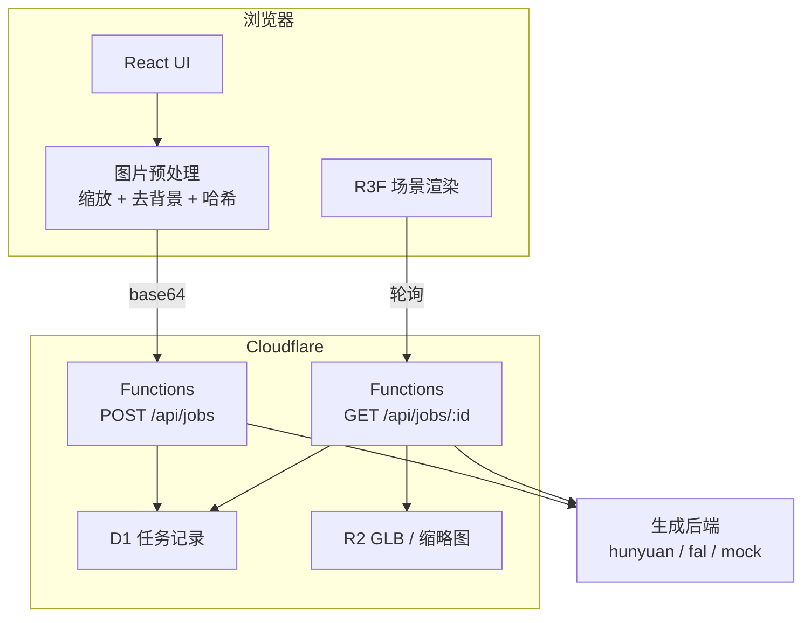

# 图片转 3D 场景应用 · 开发方案

> 代号 `p3d` ｜ v1.1 精简版 ｜ 2026-10-25
> 一句话：上传一张图 → AI 生成 3D 模型（`.glb`）→ 浏览器里转着看、摆进场景、下载走。

---

## 1. 做什么

| 做                           | 不做                                     |
| ---------------------------- | ---------------------------------------- |
| 单图 → GLB，浏览器内交互查看 | 不做精确尺寸的工程件（"看着对、量着错"） |
| 多模型摆进一个场景           | 不做骨骼动画、在线雕刻                   |
| 下载 GLB / 截图              | 不做多图摄影测量                         |
| 手机能看                     | v1 不做账号体系                          |

**技术栈**：Vite + React + TS + React Three Fiber + drei ｜ Cloudflare Pages Functions + R2 + D1
**部署**：Cloudflare Pages（免 ICP 备案，R2 出网流量免费——GLB 是大文件，这条很关键）

---

## 2. 先认清一件事

单图转 3D 是**猜**，不是**提取**。相机只记录朝它的那一面，能看到的表面不到一半，背面/底面/遮挡区的信息**在照片里根本不存在**，全靠模型按训练先验补。

所以表现为：**马克杯做得八九不离十，你自己设计的异形件基本靠编。** 这不是模型不行，是输入里真没那些信息。

由此定三条规矩：

1. **文案不许说"还原"**，只说"生成近似模型"。承诺精度 = 必然差评。
2. **必须给多视角检查手段**（旋转、预设视角、线框），让用户当场发现问题。
3. **必须让"再来一次"很便宜**——单次失败是常态，重试体验就是核心体验。

四类必然出现的毛病，各配一个兜底：

| 毛病     | 表现                    | 兜底                               |
| -------- | ----------------------- | ---------------------------------- |
| 背面幻觉 | 转到背后糊成一团        | 背面提示角标 + 预设视角            |
| 背景污染 | 桌面/手被一起建成几何体 | **强制前置去背景**（最划算的一步） |
| 尺度失真 | 模型大小任意            | 归一化到包围盒，只显示相对比例     |
| 材质糊化 | 贴图像烤糊的            | 选支持 PBR 的档位 + 线框开关       |

---

## 3. 选型

**不自建模型推理。** 真实门槛：TripoSR ~6 GB 显存、Hunyuan3D-2 合并形状+纹理 29 GB、TRELLIS 16–24 GB，都要 NVIDIA + Linux CUDA。本机不具备，租卡还要折腾环境，不划算。

**用托管 API。** 三家对比：

| 服务                      | 免费额度                | 单价                                    | 国内直连 | 备注                                     |
| ------------------------- | ----------------------- | --------------------------------------- | -------- | ---------------------------------------- |
| **腾讯混元生 3D** ✅ 首选 | 首开赠 100 积分（1 年） | 0.10 元/积分（预付）→ 一次标准 **¥2.0** | 好       | 输出 GLB，**失败不扣积分**，自带内容审核 |
| fal.ai（备选）            | 少量                    | ¥0.5–3.5/次                             | 一般     | 一个 Key 横向比 4 个模型，适合做质量基准 |
| Tripo / Meshy             | 有，但**免费档非商用**  | —                                       | 一般     | 免费产物授权受限，别忽略                 |

> 单价校正（2026-11-01 按官方《计费概述》核对，原文"1000 积分 ¥1000"是错的）：
> 积分包 **1000 积分 = ¥100**（0.10 元/积分），后付费 0.12 元/积分、按日结算。

混元积分消耗（专业版 `GenerateType`）：标准 Normal 20 ／低面数 LowPoly 25 ／仅几何 Geometry 15 ／草图 Sketch 25；
极速版图生 3D 15。附加参数叠加：PBR +10、自定义面数 +10、多视图 +10、指定输出格式 +5。
后处理：格式转换 5、UV 展开 10、绑骨蒙皮 10、纹理生成 30、智能拓扑 50。
换算：预付 ×0.10，后付 ×0.12 —— 标准档即 **¥2.0 / ¥2.4**，加 PBR 即 **¥3.0 / ¥3.6**。
任务状态 `WAIT → RUN → DONE / FAIL`；并发：专业版 3，其余 1。

**架构关键：Provider 抽象。** 生成后端是最易变的一环，绝不能把某家 SDK 写进业务代码。

```ts
// functions/api/_providers/types.ts
export interface ImageTo3DProvider {
  readonly name: string;
  submit(input: {
    imageBase64: string;
    mimeType: string;
    options: GenOptions;
  }): Promise<{ providerJobId: string }>;
  query(providerJobId: string): Promise<ProviderStatus>;
  estimateCostYuan(options: GenOptions): number; // 供成本熔断用
}

export type ProviderStatus =
  | { state: 'pending'; progress: number; stage?: string }
  | { state: 'succeeded'; glb: ArrayBuffer | string }
  | { state: 'failed'; code: string; message: string; retryable: boolean };
```

三个实现：`hunyuan.ts` / `fal.ts` / `mock.ts`，一个工厂按 `P3D_PROVIDER` 环境变量选。

**这层抽象不是纸上架构**：单测全跑 mock（零成本、离线、进 CI）；比质量只改环境变量；某家挂了切一行，用户无感。

---

## 4. 架构



**一条重要约束**：Pages Functions 免费版单请求 CPU 时间极紧，**图像处理一律放浏览器**，服务端只做转发和落盘。

---

## 5. 核心设计

### 状态机

```
queued ──> running ──> succeeded
  │           │
  └───────────┴──> failed（带 retryable，不可重试的如内容违规不显示重试按钮）
              └──> timeout（≠失败：保留 providerJobId，后台可续捞结果）
```

进度映射：0–20% 排队/预处理 ｜ 20–60% 几何 ｜ 60–95% 纹理 ｜ 95–100% 落盘

### 接口

```
POST   /api/jobs          { image, mimeType, options } → { id, status }
GET    /api/jobs/:id      → { status, progress, stage, result?, error? }
POST   /api/jobs/:id/retry
DELETE /api/jobs/:id
GET    /api/assets/:key   R2 代理（带 cache 头）
```

### 数据表

```sql
CREATE TABLE jobs (
  id TEXT PRIMARY KEY,
  image_hash TEXT NOT NULL,          -- SHA-256，用于去重
  status TEXT NOT NULL,
  provider TEXT NOT NULL,
  provider_job_id TEXT,
  options_json TEXT NOT NULL,
  glb_key TEXT, thumb_key TEXT,
  error_code TEXT, error_message TEXT,
  retryable INTEGER DEFAULT 0,
  cost_yuan REAL DEFAULT 0,
  client_ip_hash TEXT,
  created_at INTEGER NOT NULL,
  updated_at INTEGER NOT NULL
);
CREATE INDEX idx_jobs_hash ON jobs(image_hash, status);
```

**去重即省钱**：提交时按 `image_hash + options_json` 查已有成功记录，命中直接复用 GLB，零成本秒回。调试期反复测同一张图，这条能挡掉大半开销。

---

## 6. 前端三个关键点

### 6.1 图片预处理（顺序不能错）

```
文件 → 校验(≤8MB, magic bytes) → EXIF 方向校正 → 缩放长边 1024
     → 去背景 → 按 alpha 裁到主体 + 留 8% 边 → SHA-256 → 提交
```

**去背景是性价比最高的单点优化**：模型会把画面里的一切当待重建对象，桌面、手、窗户都会被"重建"成垃圾几何。这一步比换更贵的模型更有效。

用 `@imgly/background-removal`（浏览器内 ONNX，图片不出设备）。注意：首次要下 ~40 MB 权重，必须动态 `import()` 拆包 + 进度条 + 提供"跳过去背景"开关。

### 6.2 渲染配方

```tsx
<Canvas shadows dpr={[1, 2]} camera={{ fov: 40, position: [2.4, 1.8, 2.4] }}>
  <Environment preset="studio" environmentIntensity={0.9} /> {/* 零额外请求 */}
  <directionalLight position={[4, 6, 3]} intensity={2.2} castShadow />
  <directionalLight position={[-4, 2, -3]} intensity={0.6} />
  <Bounds fit clip observe margin={1.2}>
    {' '}
    {/* 自动取景 */}
    <Center>
      <Model url={glbUrl} />
    </Center>
  </Bounds>
  <ContactShadows position={[0, -0.001, 0]} opacity={0.45} blur={2.4} far={3} />
  <GridHelper args={[10, 20, '#d4d4d8', '#e4e4e7']} />
  <OrbitControls makeDefault enableDamping maxPolarAngle={Math.PI / 1.85} />
</Canvas>;
```

| 设备     | 阴影                 | DPR |
| -------- | -------------------- | --- |
| 桌面独显 | ContactShadows       | 2   |
| 桌面集显 | ContactShadows       | 1.5 |
| 手机     | **关**，纯色地面替代 | 1   |

**体积是最大敌人**：未优化的生成模型 20–50 MB，移动网络直接废。目标 ≤ 5 MB，用 `@gltf-transform` 做 Draco + 纹理转 WebP + 降采样 + weld（合并重复顶点，修生成模型的"裂缝"）。

**两个通病**：法线朝向不一致 → `side = DoubleSide`；重复顶点 → `weld`。

### 6.3 尺度归一化（不做就没法摆场景）

生成模型尺寸任意，可能 0.02 也可能 3000。

```
Y 轴向上 ｜ 底面中心对齐原点 (0,0,0) ｜ 最长边 = 1.0 单位
```

```ts
function normalizeModel(obj: THREE.Object3D) {
  const s = new THREE.Box3().setFromObject(obj).getSize(new THREE.Vector3());
  obj.scale.setScalar(1 / Math.max(s.x, s.y, s.z));
  const b = new THREE.Box3().setFromObject(obj);
  const c = b.getCenter(new THREE.Vector3());
  obj.position.set(-c.x, -b.min.y, -c.z);
}
```

界面上**不显示任何绝对尺寸**，只显示相对比例（"高:宽:深 = 1 : 0.86 : 0.94"）。

### 6.4 从"一个模型"到"一个场景"

场景 = `objects: SceneObject[]`，每个对象独立 TRS：

```ts
interface SceneObject {
  id: string;
  assetKey: string;
  position: [number, number, number];
  rotation: [number, number, number];
  scale: number; // 统一标量，保持等比
  visible: boolean;
}
```

**顺序很重要**：先做单模型场景 → 再做数组容器 → 最后做拖拽摆放。反过来要先重构一遍。

---

## 7. 成本与安全

| 项      | 做法                                                                         |
| ------- | ---------------------------------------------------------------------------- |
| 密钥    | 只存 Pages 环境变量，**绝不下发前端**；上游签名在服务端做（TC3-HMAC-SHA256） |
| CI 断言 | 构建后 grep 产物，出现 `SecretId` / `sk-` / `Bearer ` 即构建失败             |
| 上传    | ≤8MB；校验 magic bytes，不能只信 Content-Type                                |
| 限流    | 单 IP 10 次/日（KV 计数）→ 429                                               |
| 预算    | 全局日预算 ¥30（D1 聚合 `cost_yuan`）→ 402                                   |
| 熔断    | `P3D_KILL_SWITCH=1` 全站停生成，30 秒内止血                                  |
| 合规    | 上游默认过审；用户协议写明"AI 推测结果，不得用于工程/医疗/安全用途"          |
| 版权    | 免费档授权各家不同（Tripo 非商用 / Meshy CC BY 4.0），不能混为一谈           |

**没 Key 怎么办**——这是最现实的阻塞点（腾讯云个人实名一般要求满 16 周岁，未满需监护人代办）：

> 先用 `mock` 把 M0–M1 做完。此时上传、预处理、进度、场景、摆放、导出**全部 100% 完成，应用已经看起来是完整作品**。等 Key 到手只加一个 `hunyuan.ts`，其余一行不改。**别等 Key 等到心态崩了才开始写代码。**

---

## 8. 里程碑

每步结束时应用都可运行、可演示。

| 阶段   | 内容                                                         | 验收                                            | 依赖       |
| ------ | ------------------------------------------------------------ | ----------------------------------------------- | ---------- |
| **M0** | 工程骨架 + R3F 场景（光照/地面/控制器）+ 拖本地 GLB 直接渲染 | 拖个 glb 进去能转、能缩放、自动取景、有阴影     | 无         |
| **M1** | Provider 接口 + mock 全链路：上传、预处理、轮询、历史、导出  | 传图 → 假进度走完 → 渲染 → 下载成功             | 无         |
| **M2** | 接真实后端：`hunyuan.ts` 签名/提交/查询 + D1 + R2            | 真图出真 GLB，端到端 ≤90s，成本 ≤¥3             | **需账号** |
| **M3** | 去重缓存 + 限流 + 熔断 + CI 密钥断言                         | 第 11 次请求 429；预算调 0 触发 402；产物无密钥 | M2         |
| **M4** | 多模型场景 + TransformControls 摆放                          | 三模型同场景独立变换，刷新保留                  | M1         |
| **M5** | 移动端降级、错误文案、空状态、截图、部署                     | 全项验收通过                                    | M4         |

合计约 **6 天**有效开发时间（不含等账号）。M0+M1 完成即是一个可交付的完整作品。

---

## 9. 风险 Top 5

| 风险               | 概率 | 影响 | 应对                                     |
| ------------------ | ---- | ---- | ---------------------------------------- |
| 账号实名认证过不了 | 中高 | 高   | mock 保进度 + 监护人代办                 |
| 生成质量不达预期   | 高   | 中   | 去背景前置、多后端可比、文案定位为"草稿" |
| 成本失控           | 中   | 高   | 去重 + 双闸门 + 熔断                     |
| GLB 体积过大       | 高   | 中   | Draco + WebP，目标 <5 MB                 |
| 上游 API 变更      | 中   | 中   | Provider 抽象，切换 = 改一个环境变量     |

> ⚠ TRELLIS.2 的许可证在不同来源有 MIT 与"研究许可"两种说法，商用前必须查官方 LICENSE。混元社区许可也有地域排除条款。

---

## 10. 校验门

沿用既有流程，五道全过才算完成：

`tsgo --noEmit` → `biome check` → `vitest`（纯函数：裁剪、归一化、状态机、去重命中、限流）→ `vite build`（含密钥扫描）→ `playwright`（msedge channel，跑 mock 主流程）

真实 API 连通性单独脚本手动跑，不进 CI——不烧积分、不依赖外网。
